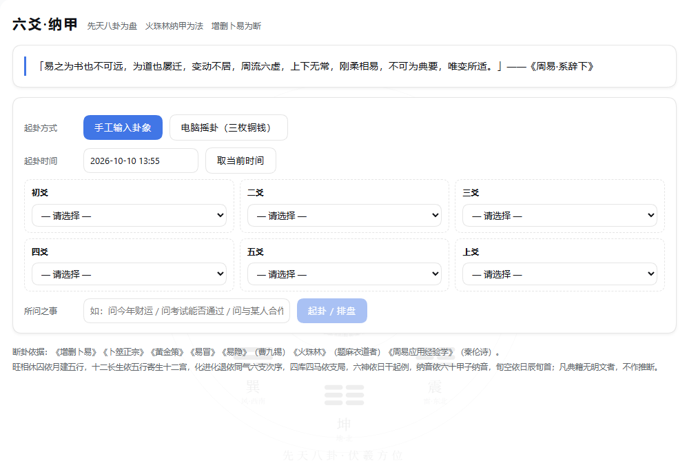
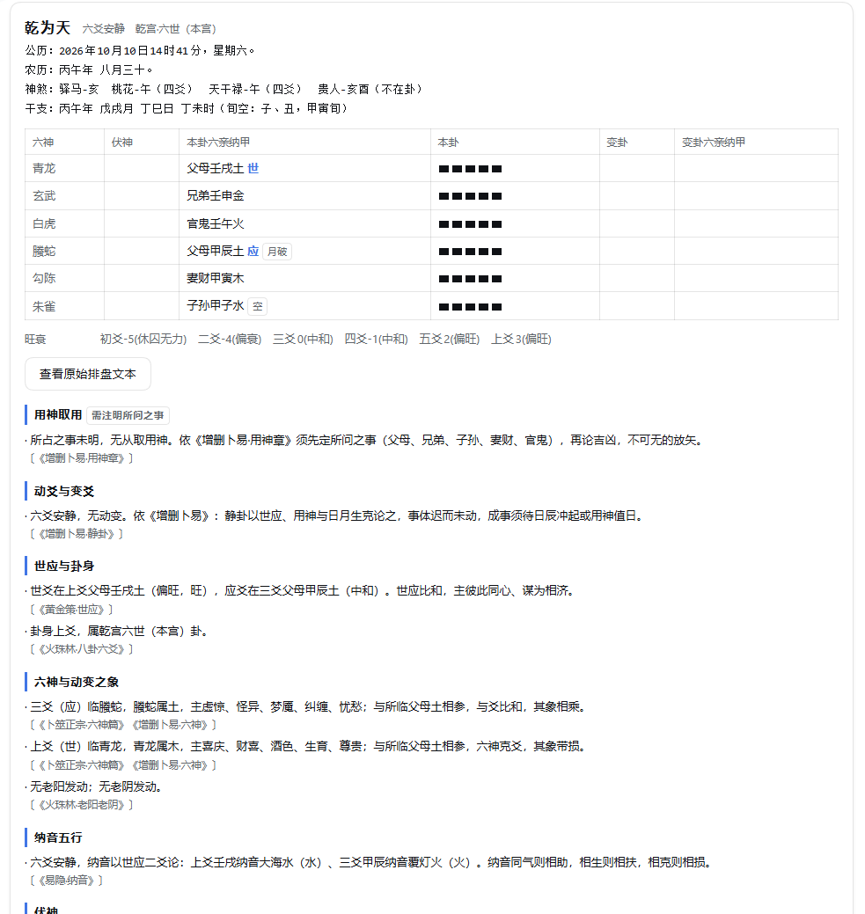
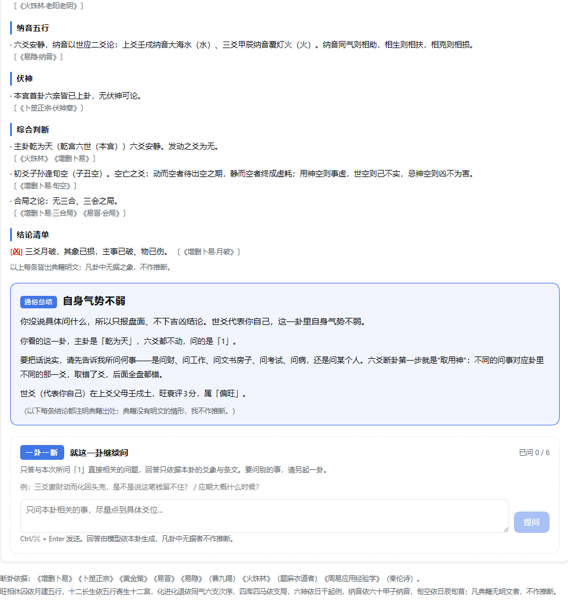

# 六爻算卦插件（dsh-liuyao）

DeepSeek Harness 的六爻插件：**先天八卦图为盘，火珠林纳甲为法，增删卜易为断**。
可开关、可离线自检；既提供界面卦盘，也把排盘与断卦依据交给 Agent 使用。

---

## 一、它能做什么

| 能力 | 说明 |
|---|---|
| 开场辞 | 起卦时从《周易》经传原文取一段（《系辞》《说卦》《序卦》及卦爻辞，一字不改） |
| 手工起卦 | 输入准确时间 + 摇出的卦（初爻→上爻）；每个选项直接标出**对应的三枚铜钱正反**（`●○○　少阳 一背二字（静）`），不熟悉术语也能填 |
| 电脑摇卦 | 模拟抛三枚铜钱，逐爻进行，每次可先确认；随机数用系统加密随机源，正反完全随机；每爻结果同步显示三枚铜钱标记 |
| 排盘 | 主卦／变卦、卦宫与世应、六亲、纳甲干支、六神、旬空、月破日冲、神煞、伏神、纳音、旺相休囚、十二长生、化进化退 |
| 断卦 | **由模型依典籍推理**（消耗 token）：盘面事实由规则引擎算出后作为不可篡改的事实交给模型，模型只做推理与表达。输出含用神取用／旺衰／动变／六神取象／世应／综合判断／结论清单／**通俗总结**，**每条断语注明典籍出处**，并硬性约束「不得改动盘面、无据不作推断、不许套话、不许迎合」。可切换为**规则断卦**（内置引擎、零 token、离线可用） |
| 一卦一断 | 解读之后带一个**追问对话框**（明确标注「一卦一断」）：只答与本次所问之事直接相关的问题，回答由模型依本卦生成；越界提问由 Host 侧**确定性判定**直接拒答（不消耗模型），并可设追问次数上限 |
| 界面 | 主面板「六爻」卦盘 + 侧栏图标；先天八卦图作为**应用基础背景层的固定底纹**（不遮盖文字与对话框、不拦截点击） |
| 关于 | 面板右上角「关于」：版本与许可、已验证环境、数据透明声明、免责与边界、**历法自检锚点**（干支历与通胜万年历的核对结果），以及咨询与赞助方式 |

## 界面

| | |
|---|---|
|  |  |
| 主面板：开场辞、起卦方式、先天八卦底纹 | 手工输入：每个选项标出对应的三枚铜钱正反 |
|  |  |
| 电脑摇卦：三枚铜钱，每抛一次前可先确认 | 排盘表、断卦条文（带出处）、通俗总结与「一卦一断」 |

## 二、开启 / 关闭

**方式一：插件总开关（Host 配置）**

在 profile 的 `cordis.patch.yml` 里为 `liuyao` 这一层加配置：

```yaml
- id: liuyao
  name: dsh-liuyao
  config:
    enabled: false          # 关闭后：工具与卦盘数据通道均不注册
    boardBackground: true   # 先天八卦底纹总开关
    backgroundMode: auto    # auto｜global｜columns｜off（见下节）
    coinAnimation: true     # 铜钱动画
    requireConfirmEachToss: true  # 每抛一次前确认
    citationStrict: true    # 只输出典籍有明文依据的断语
    analysisMode: ai        # 断卦方式：ai 由模型依典籍推理（消耗 token，默认）｜rule 内置规则引擎（零 token、离线可用）
    followUpEnabled: true   # 解读之后提供「一卦一断」追问对话框
    maxFollowUps: 3         # 同一卦允许追问的次数上限
    followUpProvider: ""    # 断卦与追问所用模型；留空用当前默认模型
    followUpModel: ""
    analysisDepth: full     # AI 断卦详细度：full 完整七段｜brief 精简五段、600 字内（明显更快）
    analysisReasoning: low      # 思考强度：low 轻度思考（默认）｜off 关闭（最快）｜high｜max｜default 跟随模型选择
    analysisMaxTokens: 0    # AI 断卦输出上限；0 不限。设 1200 左右可强制简短
```

> **AI 断卦的速度**：默认 `analysisReasoning: low`（轻度思考）。
>
> 实测数据（`deepseek-flash`，思考强度 `max`，完整模式）：
>
> ```
> 首字 134.7s　共 139.9s　输出 1849 字
> ```
>
> 也就是说 **96% 的时间花在不可见的思考上**，真正输出只用了约 5 秒。断卦是「依规则推演 + 组织语言」，
> 不需要 `max` 级的长链思考，所以默认降到 `low`——保留少量推演能力以兼顾断卦质量。
>
> 若仍嫌慢可改 `analysisReasoning: "off"`（完全关闭思考，首字最快）；
> 若觉得推理变浅可升到 `"high"`。DeepSeek 适配器只认 `off`/`low`/`high`/`max`，**没有 `medium`**。
> 另有 `analysisDepth: brief`（少 30% 提示词、输出 600 字内）与 `analysisMaxTokens` 两个旋钮。
>
> 面板上会显示每次的**首字延迟 / 总时长 / 输出字数 / 当前设置**，据此判断该调哪个。

> **断卦由谁做**：排盘（干支、纳甲、六亲、六神、世应、旬空、旺衰、长生、伏神、纳音）始终由内置规则引擎算出，
> 作为**不可篡改的事实**写进提示词；模型只负责依典籍推理与表达，并被硬性约束「不得改动盘面、无据不作推断」。
> 这样既保证盘面零错误（模型不会把甲子写成甲丑），又让断卦具备语义理解能力。
> 设为 `rule` 时改用内置规则引擎断卦，**不消耗任何 token**，适合离线或不想花额度时使用；界面上也可随时切换。

彻底停用整个插件（连 Host 半都不挂载）：

```yaml
- id: liuyao
  disabled: true
```

**方式二：界面开关**——卦盘主面板与侧栏「六爻」图标；不打开面板时插件不占界面。

### 背景为什么不盖字（重要）

先天八卦图**不是浮层**，而是一张铺在应用自身背景层上的固定底纹。原因是
`.BynINW_frame` 自带不透明背景 `var(--dsw-alias-bg-base)`：

- 放在它**后面**的元素一律看不见（被不透明底色盖住）；
- 放在它**前面**的元素就会压住正文与对话框，还可能拦截点击（`shell.overlay` 层
  `z-index:20`，且其**直属子元素**被强制 `pointer-events:auto`——原先的实现正是栽在这里）。

因此改为**铺背景、不叠浮层**，并把选择权交给 `backgroundMode`：

| 值 | 铺在哪里 | 是否可见 | 是否可能压字 |
|---|---|---|---|
| `global` | `document.body` 的 `background-image`（应用基础背景层） | 仅当应用各列未自铺不透明底色时可见 | 不可能（列底色在其之上） |
| `columns` | 应用自身的两列（`_sidebarCol`／`_centerCol`）的 `background-image` | 必然可见 | 不可能（列背景永远在列内所有内容之下） |
| `auto`（默认） | 同 `columns` | 同上 | 同上 |
| `off` | 不铺 | — | — |

两列选择器用 class 子串匹配（`[class*="_sidebarCol"]`），因为应用本体是 hash 化 CSS module，
类名随构建变化。底纹只写 `background-*` 属性，**从不触碰 `pointer-events` 与 `z-index`**，
因此不可能拦截任何点击；停用插件时底纹、标记与规则表一并清除。
尺寸上限 `min(92vmin, 940px)`、`background-attachment: fixed`，明/暗主题自动换用对应墨色。

卦盘面板内另有一层同款水印，用 `z-index:-1` 置于面板内容之下（面板自身 `isolation:isolate`），
同样位于文字与表格之下。

## 三、安装

**方式一：git 规格（在线，需机器上有 `git`）**

```bash
dsh plugin --profile web add "github:ljxdsg12/dsh-liuyao#v0.2.0"
```

实测 2.5–3.3 秒装完（DSH `0.2.0-rc.2` / pnpm `11.7.0`）。

**方式二：下载 tarball 后本地安装**

```bash
# 先从 Release 页面下载 dsh-liuyao-0.2.0.tgz
dsh plugin --profile web add ./dsh-liuyao-0.2.0.tgz
```

实测 330ms 装完，截图等文件全部随包。

装完 **重启 DSH**，再刷新界面，出现「六爻」主面板与侧栏图标。

> ⚠️ **不要**用 Release 的 tarball 直链安装：
> `dsh plugin add "https://github.com/…/dsh-liuyao-0.2.0.tgz"` 目前会报
> `ERR_PNPM_MISSING_TARBALL_INTEGRITY`。这是 DSH 安装器与 pnpm 的问题（远程 tarball 的
> lockfile 条目缺 `integrity` 字段），不是包本身的问题——同一个 tarball 走本地路径就能装上。
> 根因与已排除项见 [KNOWN-ISSUE-install.md](KNOWN-ISSUE-install.md)。
>
> git 规格请用**分支或标签**（`#v0.1.0`、`#main`），**不要用 commit 短哈希**：
> pnpm 用 `git ls-remote` 解析引用，它只返回分支与标签。

随后在 profile 的 `cordis.patch.yml` 追加一层：

```yaml
- id: liuyao
  name: dsh-liuyao
  config:
    enabled: true
```

> 注意：`cordis.patch.yml` 的**布尔开关字段是 `disabled`**（没有 `enabled:` 这个 loader 字段）；
> `config.enabled` 是本插件自己的业务开关。两者都在这里生效。

### 设计约束：零 npm 依赖

插件刻意不 import 任何 npm 包，以免加载期的模块解析问题：

- 工具用 `ctx.tools.register()` 的**原始 JSON Schema** 形式注册（不经 `defineTool`）；
  该路径只接受 `type/oneOf/properties/required/additionalProperties/items/enum/const` + 注解，
  **不接受 `type: "json"`**，且 `required` 必须是字符串数组（`src/schema-check.mjs` 复刻了这套规则做自检）。
- `Config` 用**内联 Standard Schema v1** 校验器（不经 schemastery，`~standard.validate` 契约）。
- 浏览器半与 Host 半之间走**插件自有的 exact HTTP 端点**：
  `POST /dsh-liuyao/{config,opening,selftest,toss,cast,analyze}`，返回 `{ok,value}` / `{ok,error}`。
  端点直接注册在 `ctx.webServer`（`kind:'exact'`，优先于前端静态兜底），不依赖任何可选服务；
  webServer 本身没有同源策略，故端点自带**同源门禁**（`Sec-Fetch-Site`，退化到 `Origin`/`Host` 比对）、
  256KB 请求体上限与 JSON 校验。
  > 曾经的实现走 Connection RPC 前缀通道（`ctx.inject(['connection'])`），该注册回调在运行时未触发，
  > 请求落到静态兜底处理器，界面只会看到 `HTTP 405`——已改掉。
- 客户端包没有 `styles.insert`/`host.call`（那属于动态 Cordis 闭包通道），样式用
  `<style data-plugin="dsh-liuyao">` 自注入，由模块系统在停用/HMR 时回收。

### 一卦一断的实现

追问走 `POST /dsh-liuyao/ask`（NDJSON 流式），两道关卡：

1. **Host 侧确定性判定**（`src/followup.mjs` 的 `checkScope()`，不依赖模型）：
   - 命中卦内术语（六亲、世应、动变、旬空、月破、纳音、伏神、应期……）→ 放行；
   - 明确回指本卦的追问（含"卦/爻"的指代，或"那它什么时候…"这类指代＋疑问句）→ 放行；
   - 要另起一卦／换别的卦 → 拒答并引导「另起一卦」；
   - 与卦无关（如"帮我写代码"）→ 拒答，**不消耗模型调用**。
2. **模型侧提示词约束**：把整份卦象（四柱、旬空、六爻纳甲／六亲／六神／旺衰／动变／伏神、合局、
   用神与已下结论）嵌入系统提示词，并硬性规定：只答本次所问之事、不得引入其他卦、不得编造、
   每条结论落到具体爻位并注明出处、禁用套话、卦中无据就明说"不能断"。

回答以增量流式返回，界面逐字显示；追问次数上限由 `maxFollowUps` 控制（Host 与界面双重计数）。
模型取当前会话默认模型（`ctx.agentDefaultModel`），也可在配置里单独指定 `followUpProvider`／`followUpModel`。

## 四、Agent 工具（模型侧）

| 工具 | 用途 |
|---|---|
| `liuyao_toss` | 电脑摇卦：每次抛一爻（round 1..6），返回三枚铜钱正反、爻值 6/7/8/9、爻名 |
| `liuyao_cast` | 起卦排盘 + 断卦：入参 `time`（用户给的准确时间）、`yao`（六爻数组）、`topic`（所问之事） |
| `liuyao_opening` | 取一段《周易》开场辞 |

给 Agent 的固定流程（已写进工具描述）：

1. 先输出一段《周易》开场辞；
2. 让用户给出**当前准确时间**；
3. 让用户在「手工输入卦象」与「电脑摇卦」之间选择；电脑摇卦时逐爻抛掷、每次先确认；
4. 调 `liuyao_cast` 排盘；
5. **严格依典籍解读**：旺相休囚、十二长生、四库四马、化进化退、生克合冲、六神、纳音逐项对照，凡典籍无据者不妄断，不写套话，不迎合，只给可验证的结论。

## 五、排盘依据（可核对）

### 干支历
- 日干支：以 **1949-10-01 = 甲子日** 为锚点（通胜万年历可核）推算六十甲子。
- 月干支：以**节**为界（立春、惊蛰、清明……），五虎遁起月干。
- 时干支：五鼠遁起时干；子时 23:00–00:59。
- 年干支：以**立春**为界。
- 农历：**定气定朔**天文算法（太阳视黄经求节气、Meeus 定朔求月首），非查表。
- 自检锚点（`test/calendar.test.mjs`）：
  | 日期 | 引擎输出 | 权威历书 |
  |---|---|---|
  | 1949-10-01 | 己丑年 癸酉月 甲子日 农历八月初十 | 己丑年 癸酉月 甲子日 农历八月初十 ✅ |
  | 2008-12-23 08:37 | 戊子年 甲子月 丁酉日 甲辰时 旬空辰巳 冬月廿六 | 同 ✅ |
  | 2026-10-10 | 丙午年 戊戌月 丁巳日 农历九月初一 | 同 ✅ |

### 纳甲与八宫
- 八卦纳甲：乾内甲子外壬午、坤内乙未外癸丑，震庚、巽辛、坎戊、离己、艮丙、兑丁（《火珠林》纳甲法）。
- 八宫卦序与世应：乾坎艮震巽离坤兑八宫，本宫六世、一至五世、游魂四世、归魂三世。
- 六亲：以本宫五行为「我」，生我者父母、我生者子孙、比和者兄弟、我克者妻财、克我者官鬼。
- 伏神：本宫首卦（八纯卦）某爻位之六亲为主卦六爻所无者，伏于该爻位之下；并在断卦中区分「可补缺失用神」与「仅为卦变所伏」。
- 六神：甲乙起青龙、丙丁起朱雀、戊起勾陈、己起螣蛇、庚辛起白虎、壬癸起玄武。
- 旬空：以日辰旬首定（甲子旬戌亥空……）。
- 神煞：驿马／咸池取日支三合，禄／贵人／羊刃取日干，各注依据。

### 断卦
旺相休囚（月建五行）、十二长生（五行寄生十二宫，阳顺阴逆）、化进神退神（同气六支次序）、
回头生克、化空化破、月破日冲（动散静不散）、六合六冲六害相刑、四库四马、纳音生克、
用神／原神／忌神／仇神、世应关系、反吟伏吟、三合三会与虚一待用，逐项附书名篇目。
**凡典籍无明文者不出断语**；用神未定（未注明所问之事）时只排盘、不取用。

## 六、自检与测试

```powershell
node test/calendar.test.mjs    # 干支历 / 农历 / 节气
node test/hexagrams.test.mjs   # 六十四卦表、纳甲、八宫世应、伏神
node test/engine.test.mjs      # 排盘输出（对照参考图）
node test/analysis.test.mjs    # 断卦依据
node test/host.test.mjs        # Host 半：工具、RPC、包解析（含桩件）
node test/client.test.mjs      # 浏览器半：bundle 形状、槽位、SVG、端点一致性
```

## 七、结构

```
liuyao-dsh-plugin/
├─ package.json          # dsh.bundle.patch + dsh.client.platform
├─ cordis.patch.yml      # profile 层（insert 本插件）
├─ lib/index.js          # Host 半：内联 Config 校验器、三个工具（原始 JSON Schema）、/dsh-liuyao RPC 通道
├─ client/client.js      # 浏览器半：先天八卦 SVG、卦盘、摇卦、断卦展示（自带 <style data-plugin>）
└─ src/
   ├─ constants.mjs      # 纳甲、八宫、六亲、六神、长生、神煞、地支关系
   ├─ calendar.mjs       # 干支历、农历、节气、旬空
   ├─ hexagrams.mjs      # 六十四卦索引、纳甲装配、世应、伏神
   ├─ engine.mjs         # 起卦、摇卦、排盘、旺衰评分、三合局、用神取用
   ├─ analysis.mjs       # 断卦依据（用神/原神/忌神/仇神、动变、六神、纳音、综合、结论）
   ├─ format.mjs         # 文本排盘（同参考图顺序）
   ├─ opening.mjs        # 《周易》开场辞
   ├─ schema-check.mjs   # 原始 JSON Schema 子集校验器（复刻 dsh-tools 规则）
   └─ cli.mjs            # 命令行排盘（可离线使用）
└─ skills/
   └─ liuyao-divination.md  # Agent 作业规程（起卦流程／断卦九步／纪律）
```

## 八、与参考图的两处差异（已按典籍标准实现）

参考图（2008-12-23 8:37）有两处与标准黄历／卦理不符，本插件按标准实现：

1. **日柱**：图为「丙午日」，标准为 **丁酉日**（通胜万年历核对一致）。旁证：图中六神列自下而上为
   朱雀、勾陈、螣蛇、白虎、玄武、青龙，正是「丙丁起朱雀」的排法——说明程序内部用的是**丁日**，图面日柱显示有误。
2. **变卦**：图作「雷山小过(兑宫)」并标世四应初。按图上动爻（三爻、上爻动）由 101001 翻转得 **000001 = 地雷复（坤宫一世，世初应四）**，与图中世应标注一致。

## 九、命令行用法

```powershell
node src/cli.mjs --opening
node src/cli.mjs --time "2026-10-10 12:08" --yao 7,8,8,7,7,7 --topic "问事业"
node src/cli.mjs --now --toss --topic "问财运"
```
